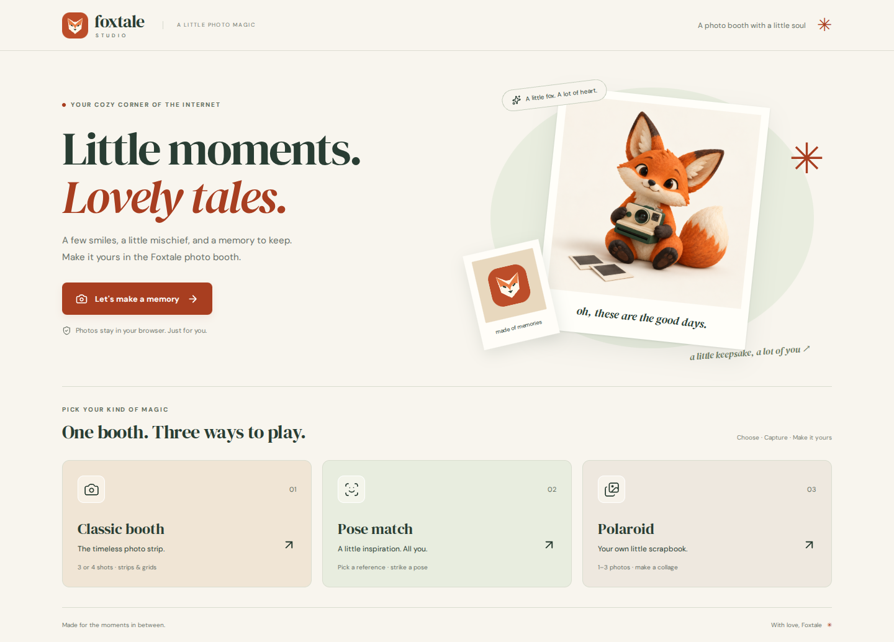

# Foxtale studio refresh

The studio now has a warm cream, terracotta and forest-green identity, a scalable fox mark, a new fox-and-camera illustration, and self-hosted DM Sans / DM Serif Display fonts (licenses in `public/fonts`).

- Home gives each mode its own card and a direct Classic booth entry.
- The birthday entry keeps the existing code, with a labeled field, explicit submit action, and inline error message.
- Layout choices use consistent previews and compact mobile cards.
- Uploads are available alongside the camera, with original uploaded image data retained.
- The editor has a Foxtale sticker category, matching paper colors, and keyboard focus restored to the canvas after item selection.
- Pose reference thumbnails preserve their aspect ratio.
- Camera frames use native cropped resolution and lossless PNG encoding first, with JPEG fallbacks.
- Exports use a 1200px short edge and a 4096px long-edge bound. The Polaroid double-scaling error is fixed. Output detail still depends on the original photo and camera.
- TypeScript errors present in the original source are repaired; `build` now runs `tsc --noEmit` before bundling.

## Preview

[Mobile preview](foxtale-mobile.png)

## Verification

Checked in Chromium at desktop and phone sizes: birthday entry, all three mode paths, uploads, captions, filters, fox stickers, preview and PNG download. Simulated camera countdown/capture was exercised; physical camera hardware was not available. Checked home/setup for horizontal overflow at 320, 390, 768, 1024 and 1440px widths.

Measured PNG output: 4-shot strip 1200×3707, 2×2 grid 1200×1200, Polaroid 1200×2133, one-pose comparison 1200×2053. Verified visible editor images load, and no uncaught page errors occur.

Commands: `npm run typecheck`, `VITE_BASE=/foxtale-studio/ npm run build`, `git diff --check`.

## Illustration provenance

`public/brand/fox-hero.webp` was created using the built-in image generation tool. The vector mark and fox-face sticker are project-native SVG assets.

Prompt:

> Create a polished illustration asset for Foxtale Studio, a warm playful fox-themed personal photo booth website. A charming small orange fox with cream muzzle, black paws, oversized pointed ears and fluffy white-tipped tail, holding a vintage cream and dark forest green camera, sitting beside two small blank instant-photo prints. Tactile matte clay / paper sculpture style, subtly textured, premium editorial art direction, charming rather than babyish. Warm ivory seamless background #f8f4eb, softly diffused studio light, gentle grounded shadow, rust orange and forest green palette. Single centrally composed fox, full body visible with generous breathing space. Square image. No text, letters, logos, watermark, borders or interface. Crisp high quality edges and details.
